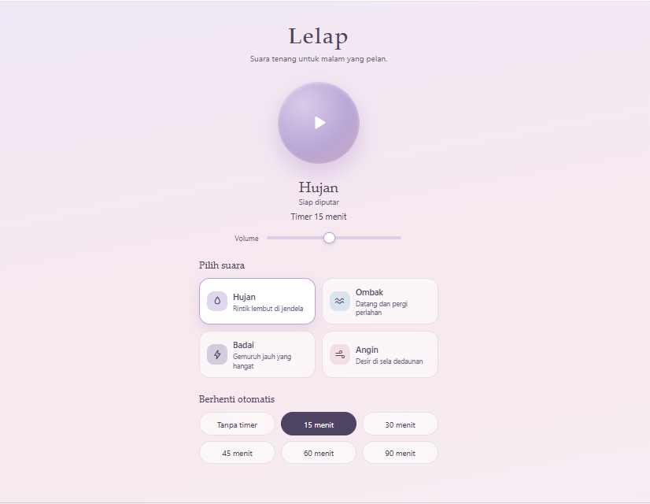

# Lelap – White Noise Sleep

Aplikasi pemutar audio relaksasi untuk membantu mengatasi susah tidur, dibuat dengan **HTML, CSS, dan JavaScript** sebagai proyek UTS Mobile Programming.

Tampilannya memakai warna lembut (lavender dan blush) supaya menenangkan dan tidak menyilaukan di malam hari.



## Identitas

| | |
|---|---|
| Nama | [RANI] |
| NIM | [243026021] |
| Kelas | [SISTEM INFORMASI] |
| Mata kuliah | PEMROGRAMAN MOBILE|

## Fitur

1. **Pemutar audio dengan looping.** Suara diputar berulang terus sampai dihentikan (`audio.loop = true`).
2. **Pilihan suara.** Hujan, Ombak, Badai, dan Angin, masing-masing dengan ikon. Suara bisa diganti saat sedang diputar.
3. **Sleep timer.** Pilihan 15, 30, 45, 60, atau 90 menit, atau tanpa timer. Sisa waktu tampil di bawah tombol putar. Saat waktu habis, volume memudar pelan selama 6 detik lalu berhenti.
4. **Pengatur volume** dengan slider.

## Penjelasan Tampilan

Halaman disusun satu kolom dari atas ke bawah:

1. **Judul** "Lelap" beserta kalimat singkat.
2. **Tombol putar besar** di tengah. Saat suara menyala, ikon berubah menjadi jeda dan muncul animasi lingkaran yang "bernapas".
3. **Nama suara, status, dan sisa timer** tepat di bawah tombol, sehingga mudah dilihat saat berbaring.
4. **Slider volume.**
5. **Pilih suara.** Empat kartu dalam grid 2 kolom. Kartu yang aktif berwarna putih dengan garis ungu.
6. **Berhenti otomatis.** Enam tombol timer dalam grid 3 kolom. Tombol yang aktif berwarna ungu tua.

## Teknologi

| Teknologi | Kegunaan |
|---|---|
| HTML5 | Kerangka halaman |
| CSS3 | Tampilan, warna, animasi, tata letak grid |
| JavaScript (vanilla) | Logika pemutar, timer, dan pembuatan kartu suara |
| HTML5 `Audio` | Memutar file mp3 dengan looping |
| Web Audio API | Suara cadangan buatan kalau file mp3 tidak ditemukan |

Aplikasi **tidak memakai library atau framework eksternal**.

## Struktur Folder

```
White Noise Sleep/
├── README.md
├── index.html       
├── css/
│   └── style.css    
├── js/
│   └── app.js       
├── audio/
│   ├── hujan.mp3
│   ├── ombak.mp3
│   ├── badai.mp3
│   └── angin.mp3
└── screenshots/
    └── tampilan-aplikasi.png
```

## Cara Menjalankan

**Cara 1:** buka file `index.html` lalu klik kanan dan open with live server.

**Cara 2 (server lokal):**

```bash
cd "White Noise Sleep"
npx http-server -p 5500 -c-1
```

Lalu buka `http://127.0.0.1:5500`. Untuk mencoba di HP, buka alamat jaringan yang tampil di terminal (misalnya `http://192.168.x.x:5500`) dengan HP dan laptop di Wi-Fi yang sama.

## Alur Program

1. Pengguna memilih suara dan (opsional) timer.
2. Pengguna menekan tombol putar, lalu `setPlaying(true)` dipanggil.
3. `startSound()` membuat objek `Audio`, mengaktifkan `loop`, dan memutar file.
4. Kalau timer dipilih, `startTimer()` mencatat waktu berakhir (`endAt`) dan memeriksanya setiap 0,5 detik dengan `setInterval`.
5. Saat waktu habis, `fadeOutAndStop()` menurunkan volume selama 6 detik, lalu `setPlaying(false)` menghentikan semuanya.

## Penjelasan Kode Penting

**Looping** (`js/app.js`)

```js
audioEl = new Audio(current.src);
audioEl.loop = true;
audioEl.play();
```

**Sleep timer**

```js
endAt = Date.now() + timerMin * 60000;
tick = setInterval(onTick, 500);
```

Waktu berakhir dicatat sekali, lalu dibandingkan dengan jam sekarang. Cara ini tetap akurat walau browser sempat tertunda.

**Fade-out**

```js
fade = Math.max(0, 1 - (Date.now() - start) / FADE_MS);
audioEl.volume = volume * fade;
```

**Daftar suara berbasis data.** Kartu suara dibuat otomatis dari array `SOUNDS`, jadi menambah suara baru cukup menambah satu baris.

```js
{ id: 'hujan', name: 'Hujan', desc: 'Rintik lembut di jendela',
  color: '#B9A7D6', src: 'audio/hujan.mp3', icon: '...' }
```

## Pengembangan Selanjutnya

- Menyimpan riwayat tidur dan preferensi pengguna dengan database (misalnya Firebase).
- Mode malam yang meredupkan layar.
- Mencampur dua suara sekaligus.
- Membungkus aplikasi dengan Apache Cordova menjadi APK.
